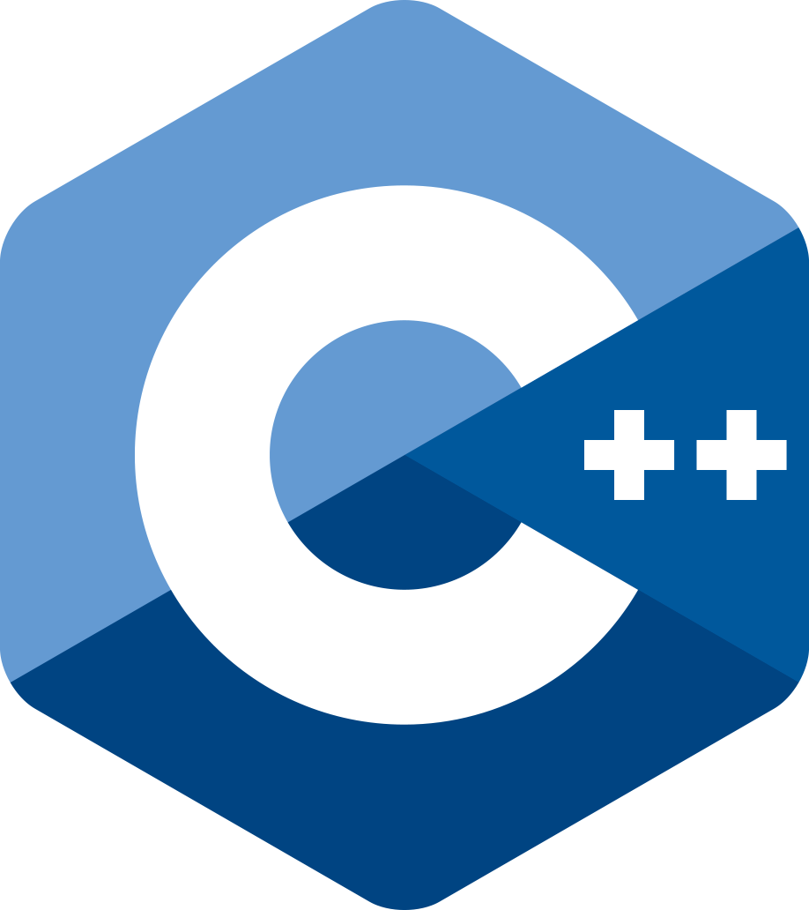
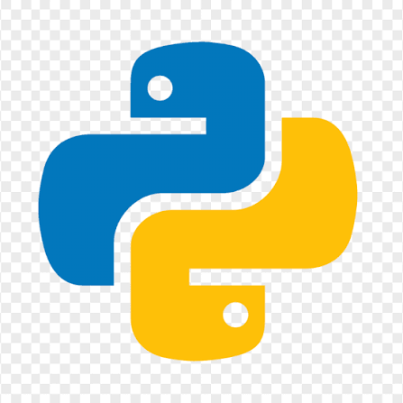
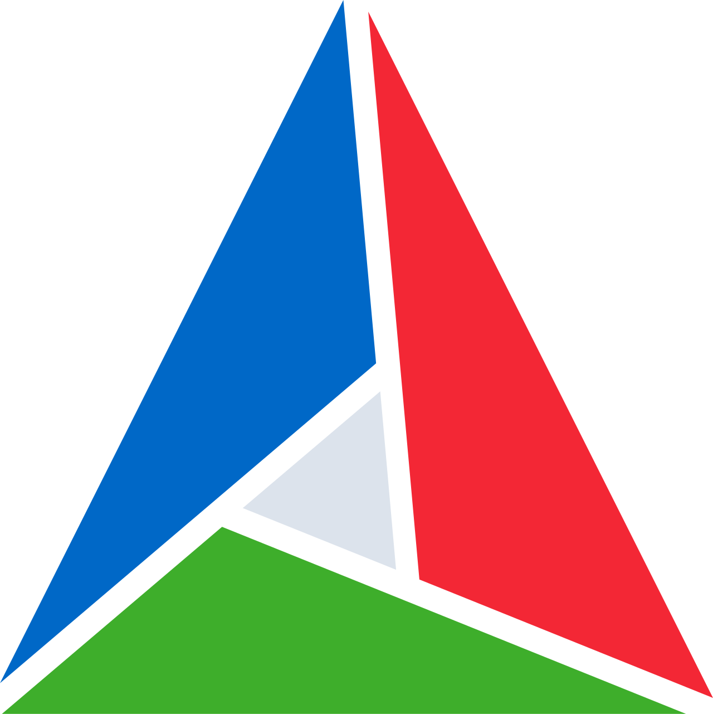
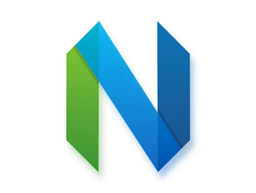
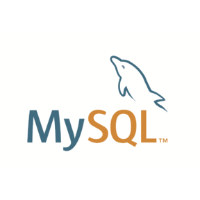
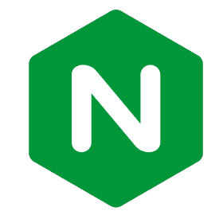

# 👋 Hello there! I'm Aiden Yuan 

*Game server developer focused on C++ network programming*

- 💬  I like to talk about MMORPG, C++ and Arch Linux
- 🌱  Learning MMORPG server architecture from [TrinityCore](https://github.com/TrinityCore/TrinityCore)
- 📖  Learn more about my projects on my [blog](https://blog.aidenyuan.com/en/)
- 🛠️  Check out my [dotfiles](https://github.com/AidenYuanDev/dotfiles) — minimalist bspwm, polybar, picom and neovim configs for Arch Linux
- 📫  You can reach me via WeChat(AidenYuanDev) or email(aiden.yuan.dev@gmail.com).

## 🔧 Projects

- [starry](https://github.com/AidenYuanDev/starry) — A C++ network library modernizing [muduo](https://github.com/chenshuo/muduo) with C++17/20 (Reactor pattern, epoll, protobuf-based RPC, async logging)
- [StarryChat](https://github.com/AidenYuanDev/StarryChat) — A chat server built on starry, with MariaDB connection pooling and Redis caching

## Favorite Tech
> Tools, languages, and other things that I like to work with.

<table>
  <tr>
    <td align="center" width="96"> C++</td>
    <td align="center" width="96"> Python</td>
    <td align="center" width="96"> Lua</td>
    <td align="center" width="96"> Boost</td>
    <td align="center" width="96"> Protobuf</td>
    <td align="center" width="96"> Reactor</td>
  </tr>
  <tr>
    <td align="center" width="96"> CMake</td>
    <td align="center" width="96"> Neovim</td>
    <td align="center" width="96"> Arch Linux</td>
    <td align="center" width="96"> MySQL</td>
    <td align="center" width="96"> PostgreSQL</td>
    <td align="center" width="96"> Nginx</td>
  </tr>
</table>
